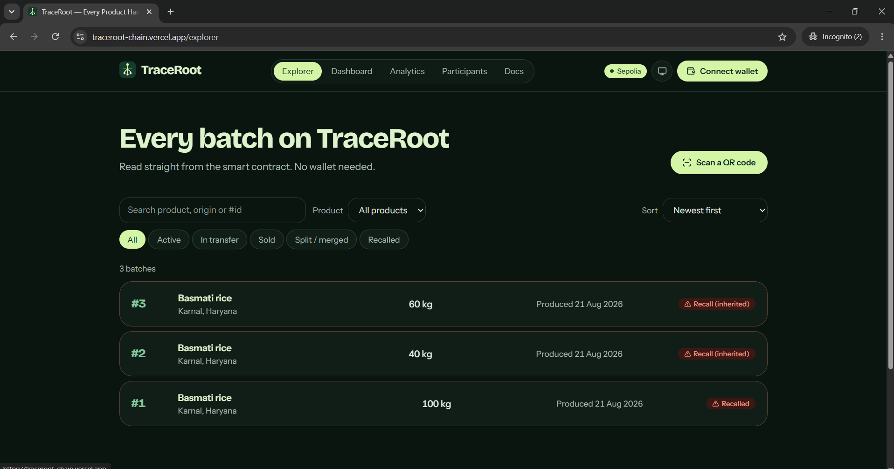
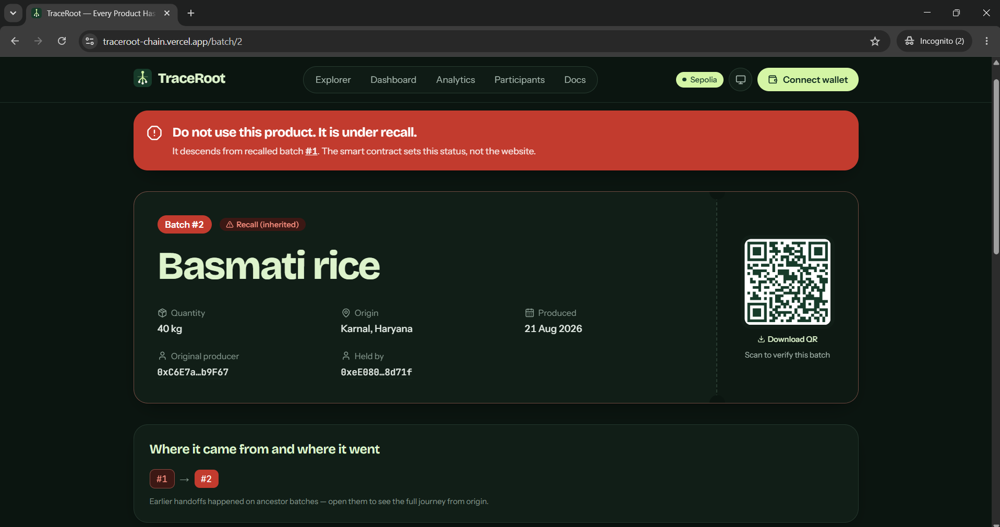
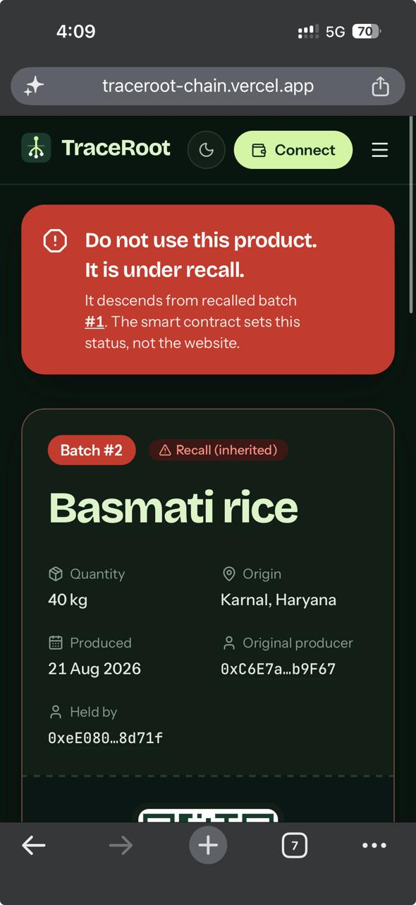
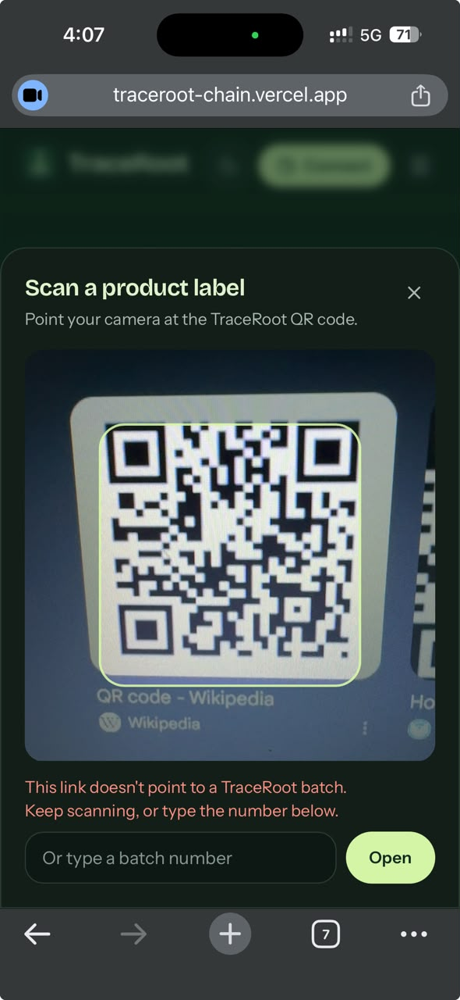
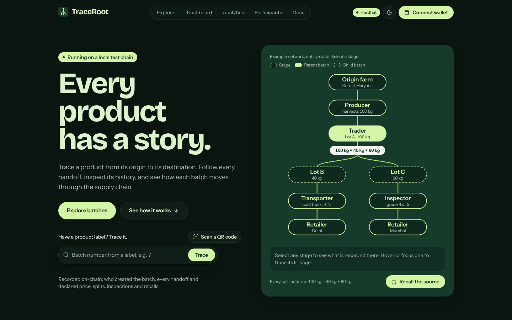
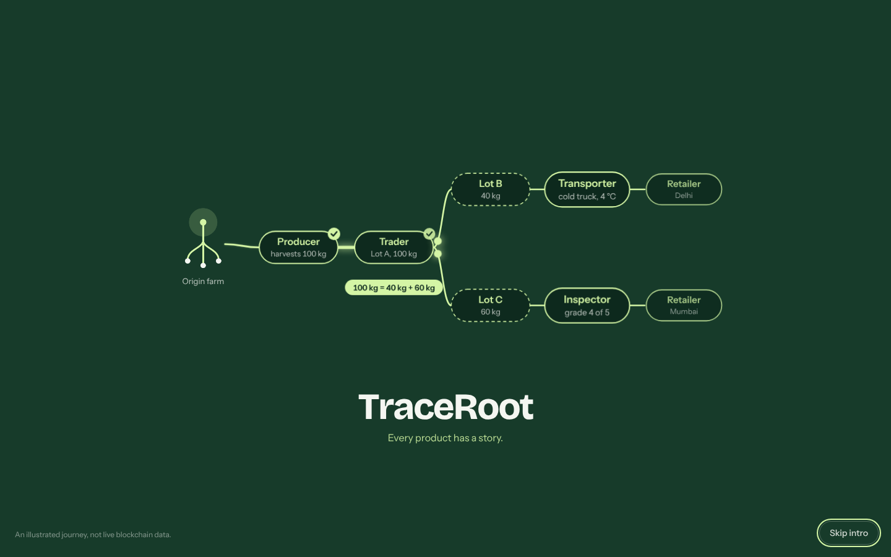
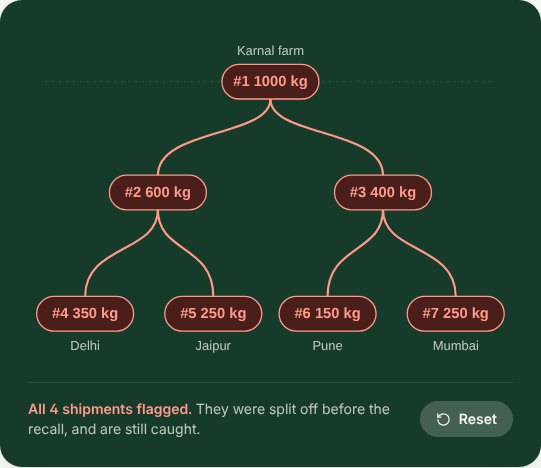
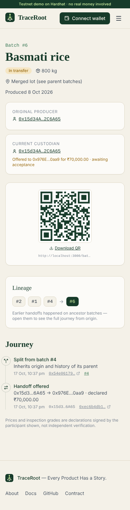
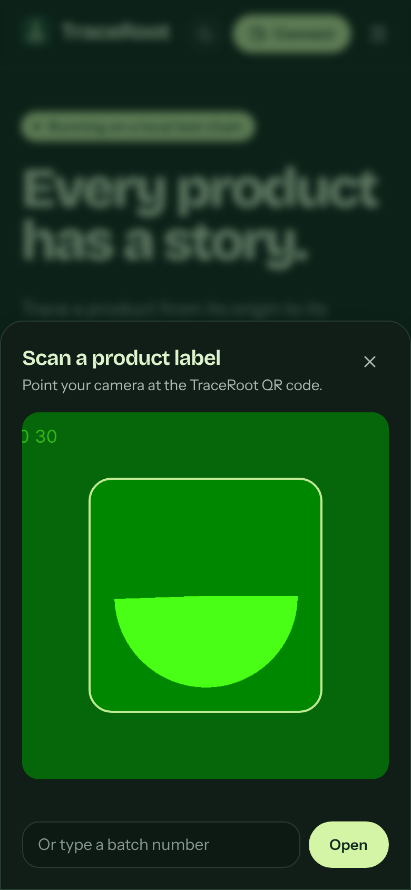

# TraceRoot — Every Product Has a Story.

**Trace Every Batch. Verify Every Handoff.**

TraceRoot is a blockchain supply chain provenance platform. It records every batch of a product from its origin to the consumer: who produced it, every handoff (signed by both sides), every split and merge (with quantities that must add up), inspections, declared prices and recalls. Anyone can scan a QR code and see the full story without a wallet.

> Runs on the public **Sepolia testnet** with free tools only. No real money is involved.

| | |
|---|---|
| Live site | [traceroot-chain.vercel.app](https://traceroot-chain.vercel.app) (Vercel, free tier) |
| Contract | [`0x0B90219475dDa20b61FD59E68d2110397BEb3831`](https://sepolia.etherscan.io/address/0x0B90219475dDa20b61FD59E68d2110397BEb3831#code), source verified on Etherscan |
| Deployment | [transaction](https://sepolia.etherscan.io/tx/0x6651fca1c0a6d1db659dd0d16a84180b84fe8d6335a36b15a7e7ba1754f110cf), block 11,940,207, 18 Oct 2026 |
| Network | Ethereum Sepolia (chain 11155111). Polygon Amoy and a local chain are also supported |

### Live on Sepolia

Real screenshots of the deployed site after a full journey on the testnet: batch #1 (100 kg) was split into #2 (40 kg, later sold) and #3 (60 kg, inspected), then #1 was recalled.

| Explorer, read straight from the contract | A sold lot that inherited the recall |
|---|---|
|  |  |

| On an iPhone (Safari, HTTPS) | In-site scanner rejecting a non-TraceRoot QR |
|---|---|
|  |  |

### Local development

| Light | Dark |
|---|---|
|  |  |

| The Origin Sequence (opening animation) | Recall demo on the landing page |
|---|---|
|  |  |

| Recalled batch on a phone | In-site QR scanner |
|---|---|
|  |  |

_Screenshots are from a local Hardhat chain seeded with `npm run seed:local`. The scanner shot uses Chromium's built-in test camera pattern, not a real product label._

### On the website

- **Scan a label in the browser.** "Scan a QR code" opens the rear camera only when pressed, validates what it reads, asks before following a link to another site, and stops the camera on close or when you leave the page. Typing the batch number always works, including when camera access is denied. The camera needs HTTPS (or localhost).
- **Light and dark themes.** Follows the device by default; the header toggle cycles device → light → dark and remembers the choice. The theme is applied before the first paint, so there is no flash.
- **Self-hosted fonts** (Bricolage Grotesque, Instrument Sans, JetBrains Mono, all SIL OFL 1.1) loaded with `next/font/local`. No requests to font CDNs.
- **Reduced motion respected.** The opening animation is skipped, and every other animation jumps to its end state.

## What the contract guarantees

- **Two-step handoffs.** Custody moves only when the recipient accepts. Offers expire after 7 days; either side can cancel.
- **Quantity conservation.** A split consumes the parent and its parts must sum exactly to it. A merge sums compatible batches (same product and unit). Quantity can never be created.
- **Inherited recalls, computed on-chain.** `isRecalled(id)` walks the batch's ancestry, so a child created *before* a recall is flagged instantly. No indexer delay can show a recalled product as safe. Ancestry is capped at 64 nodes to keep this cheap.
- **Role-based access.** Administrator, Producer, Trader, Transporter, Inspector, Retailer, all enforced in Solidity with OpenZeppelin `AccessControl`.
- **Declared prices** in INR paise, recorded at each handoff and at sale.
- **History from events.** Each batch stores only the block numbers of its events, so the site rebuilds a timeline with exact single-block log queries that work on free RPC tiers.

### Honest limitations

A blockchain proves *who signed what, and when*. It cannot verify that a physical product matches its record (the oracle problem). Inspections and prices are declarations by accountable participants, not physical proof.

## How the pieces fit

```
Browser (Next.js, wagmi + viem) ──reads──▶ public RPC ──▶ TraceRoot contract (source of truth)
        │                                                    ▲
        └── wallet (MetaMask) signs writes ──────────────────┘
```

- **No backend, no indexer, no database.** Every page reads the contract directly. Current state comes from `getBatch`, `isRecalled` and `pendingTransfer`; history comes from events.
- **History without an indexer.** The contract records the block numbers of every event touching a batch (`getEventBlocks`). The site fetches logs for exactly those blocks, which works on free RPCs that limit `eth_getLogs` ranges.
- **Lists read the newest 500 batches.** Explorer, dashboard, analytics and participants say so on the page if there are more; any batch can still be opened by number.
- **Wallets are optional.** Checking a product never needs one. Writes are simulated first (so contract errors show before signing) and reported as successful only after the receipt confirms.

## Demo workflow

`npm run seed:local` creates six batches covering a handoff with a cold-chain reading, an inspection, a merge, a split, a retail sale, a recall and a pending offer. To walk the full journey yourself, import Hardhat's test keys into MetaMask (the seed script uses accounts 1–6 for producer, second producer, transporter, trader, inspector and retailer):

1. **Producer:** *Dashboard → Batches → Create a batch*, then *Transfers → Offer a handoff* to the trader.
2. **Trader:** *Dashboard* shows the offer; *Confirm receipt*. Then *Batches → Split* (for example 40, 60; the form checks the sum live).
3. **Transporter:** accept a lot, *Log a condition reading*, and offer it to the retailer. The retailer can **Decline** or **Confirm receipt**.
4. **Inspector:** *Inspections → Record an inspection*.
5. **Retailer:** *Batches → Mark as sold*.
6. **Administrator or inspector:** *Recalls → Issue a recall* on the origin batch.
7. **Anyone, no wallet:** open `/batch/<id>` or scan its QR code. Descendants show "Do not use this product", including lots already sold.

The browser test `web/tests/e2e/workflow.spec.ts` runs exactly this journey and checks each step against contract state.

## Repository layout

```
contracts/   Solidity contract, Hardhat tests, deploy scripts
web/         Next.js 15 app (TypeScript, Tailwind, wagmi + viem, Recharts)
docs/        Architecture, security notes, progress log
```

## Run it locally

```bash
# 1. Contracts
cd contracts
npm install
npx hardhat test                # 51 tests
npx hardhat coverage

# 2. Local chain with demo data (three terminals)
npx hardhat node
npm run deploy:local && npm run seed:local

# 3. Web app
cd ../web
npm install
printf "NEXT_PUBLIC_CHAIN=localhost\nNEXT_PUBLIC_CONTRACT_ADDRESS=0x5FbDB2315678afecb367f032d93F642f64180aa3\n" > .env.local
npm run dev                     # http://localhost:3000
```

To act as a participant locally, import one of Hardhat's printed test private keys into MetaMask and add the network `http://127.0.0.1:8545`, chain ID 31337.

## Deploy for free (testnet)

The live demo was deployed to Sepolia this way. Replace `sepolia` with `amoy` to use Polygon Amoy instead (Amoy faucets currently ask for a mainnet balance).

1. **Make a dedicated test wallet** in MetaMask. Never use a wallet that holds real funds.
2. **Get free test ETH** for Sepolia, for example from the Google Cloud Web3 faucet, QuickNode or Chainlink. About 0.05 ETH is plenty.
3. **Configure**: copy `contracts/.env.example` to `contracts/.env` and fill in `DEPLOYER_PRIVATE_KEY`, `SEPOLIA_RPC_URL` (for example `https://ethereum-sepolia-rpc.publicnode.com`) and a free `ETHERSCAN_API_KEY`. `.env` is git-ignored.
4. **Deploy**:
   ```bash
   cd contracts
   npm run deploy:sepolia
   ```
   This writes `deployments/sepolia.json` (address, tx hash, block) and a copy for the web app. Commit both; they contain only public data.
5. **Verify source**: `npx hardhat verify --network sepolia <address> <adminAddress>`
6. **Grant roles** to participant wallets from the site's *Dashboard → Admin* tab, or:
   `ROLE=PRODUCER ACCOUNT=0x... npx hardhat run scripts/grant-roles.js --network sepolia`
7. **Host the site on Vercel** (free): import the GitHub repo, set *Root Directory* to `web`, and add `NEXT_PUBLIC_CHAIN=sepolia`, `NEXT_PUBLIC_CONTRACT_ADDRESS=<address>` and optionally `NEXT_PUBLIC_RPC_URL`. These are baked in at build time, so redeploy after changing them.

The deploy script refuses to run on any chain except Amoy, Sepolia and local Hardhat. There is no mainnet configuration.

## Testing

| Command | What it does |
|---|---|
| `web: npm run lint` | ESLint (Next.js core web vitals + TypeScript rules) |
| `web: npm test` | 19 unit tests: example network lineage, role permissions, form parsers, error classification, QR content validation, offer expiry |
| `web: npm run test:e2e` | 41 Playwright browser tests against a seeded local chain, including the full supply-chain journey with one wallet per role (each step checked against contract state), declining and expired offers, wrong network, an RPC failure after sending, roles, intro, theme, keyboard access, and QR scanning with a simulated camera (see `web/tests/e2e/README.md`) |
| `contracts: npm test` | 51 contract tests: a full workflow with state and event checks at every step, unauthorized callers, repeated operations, boundary values (part counts, uint128 limits, byte-length text limits, grades, dates), recall inheritance through split → merge → split, pause behaviour, randomized quantity invariant |
| `contracts: npm run coverage` | 100% line and function coverage, 84.8% branch coverage |
| `contracts: npm run slither` | Static analysis; see `docs/SECURITY.md` for triage |

The test suite includes a randomized split/merge invariant test showing total active quantity never changes. This is automated testing, not a formal audit. Passing tests do not prove the contract is secure; see `docs/SECURITY.md` for the review notes and known risks.

## Known issues and next steps

- **Deployed on Sepolia, not Amoy.** Amoy faucets now require a mainnet balance, so the live demo runs on Sepolia; the code supports both.
- **Single administrator key.** Fine for a demo; production would use a multisig.
- **No indexer.** List pages read up to 500 batches through the RPC. Beyond a few hundred batches a free indexer (for example a subgraph) would be faster.
- **Camera scanning needs HTTPS.** Tested on an iPhone (Safari) against the live site; Android Chrome is still untested.
- **MetaMask may warn about the site** ("Continue at your own risk"). New `*.vercel.app` sites that connect wallets are often flagged automatically; a false-positive review has to be requested from MetaMask support. The contract is verified and the code is open source.
- **Browser tests run locally only** (they need a seeded chain); CI runs the contract tests, type check, lint, unit tests and the build.
- **Dependency advisories** sit inside wallet libraries this site doesn't use (WalletConnect, MetaMask SDK) and Next's build-time PostCSS. Fixing them needs major upgrades; they are tracked in `docs/SECURITY.md`.

## Tech stack

Solidity 0.8.24 · OpenZeppelin 5 · Hardhat · Next.js 15 · TypeScript · Tailwind CSS · wagmi 2 · viem · Recharts · qrcode · @zxing/browser · GitHub Actions

---

Built by **Sujal Tyagi** · [GitHub](https://github.com/Sujal-tyagi17)
