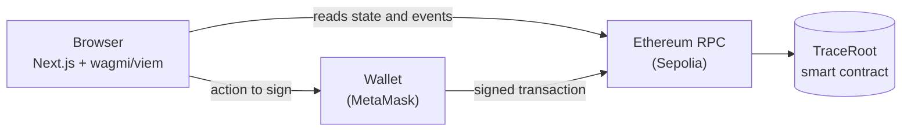

<div align="center">


# TraceRoot

### Every product has a story.

**Trace every batch. Verify every handoff.**

A blockchain supply-chain tracker: every batch, handoff, split, inspection and recall is recorded on Ethereum, and anyone can check a product by scanning its QR code. No wallet needed.

[**Live demo**](https://traceroot-chain.vercel.app) &nbsp;·&nbsp;
[**Repository**](https://github.com/Sujal-tyagi17/TraceRoot) &nbsp;·&nbsp;
[**Verified contract**](https://sepolia.etherscan.io/address/0x0B90219475dDa20b61FD59E68d2110397BEb3831#code) &nbsp;·&nbsp;
[**Architecture**](docs/ARCHITECTURE.md)

<br />

<a href="https://skillicons.dev"></a>


</div>

<br />

<p align="center">
  
</p>

## Screenshots

All screenshots are from the live site on Sepolia.

<table>
  <tr>
    <td width="50%" valign="top"><br /><sub><b>Dashboard.</b> Each wallet sees only the actions its on-chain roles allow.</sub></td>
    <td width="50%" valign="top"><br /><sub><b>Explorer.</b> Every batch, read straight from the contract, with search and filters.</sub></td>
  </tr>
  <tr>
    <td valign="top"><br /><sub><b>Inherited recall.</b> Batch #2 was already sold when its source batch #1 was recalled, and it is still flagged.</sub></td>
    <td valign="top"><br /><sub><b>Batch history.</b> Lineage, a signed inspection grade, and every step with its transaction link.</sub></td>
  </tr>
  <tr>
    <td valign="top"><br /><sub><b>Analytics.</b> Worked out in the browser from on-chain records, never estimated.</sub></td>
    <td valign="top" align="center"> <br /><sub><b>On a phone.</b> A recall page, and the in-site scanner rejecting a QR code that isn't TraceRoot's.</sub></td>
  </tr>
</table>

## Core features

- **Two-step handoffs.** The current holder offers a batch; custody moves only when the receiver confirms they have it. Nobody can push goods onto someone else's record. Offers expire after 7 days and can be declined or withdrawn.
- **Quantity can't appear out of nowhere.** Splitting 100 kg into 40 + 60 is accepted; 40 + 70 is rejected. Merges add up their sources exactly.
- **Recalls follow the product.** Recalling a batch flags every batch made from it, including lots split off earlier and lots already sold. The contract works this out itself, so no website or database can hide it.
- **Roles enforced by the contract.** Producer, Trader, Transporter, Inspector, Retailer and Administrator. The dashboard hides what you can't do, but the contract is what actually refuses it.
- **Check a product without a wallet.** Scan the QR code on a label, or type the batch number, to see its origin, journey, inspections and recall status.
- **Inspections and declared prices.** Grades (1–5) and prices (₹) are recorded at each step and signed by the participant. They're shown as declarations, not proof.
- **Clear transaction feedback.** Each action is simulated before you sign, so mistakes show up in plain language first. "Confirmed" appears only after the blockchain confirms. Rejected, failed and "sent but not confirmed yet" each get their own message.
- **Built for everyone.** Light and dark themes, reduced motion, keyboard navigation and an in-site QR scanner that uses the camera only when asked.

## Architecture



- **The contract is the source of truth.** There's no backend, database or indexer. Every page reads the contract directly.
- **History without an indexer.** The contract stores the block numbers of each batch's events, so the site fetches logs for exactly those blocks. This stays within free RPC limits.
- **Bounded recall checks.** Ancestry is capped at 64 batches, so checking a recall stays cheap.

More detail: [`docs/ARCHITECTURE.md`](docs/ARCHITECTURE.md) · [`docs/SECURITY.md`](docs/SECURITY.md)

## Try it

1. Open the [live demo](https://traceroot-chain.vercel.app) and go to **Explorer**. Batch #1 is recalled; #2 (sold) and #3 inherit the recall.
2. Open a batch and scan its QR code with your phone.
3. To act as a participant, connect MetaMask on Sepolia and ask the administrator for a role.

## Run locally

Requires Node.js 20+.

```bash
# 1. Contracts and tests
cd contracts
npm install
npx hardhat test                       # 51 tests

# 2. Local chain with demo data (keep this terminal open)
npx hardhat node
# in a second terminal, still in contracts/
npm run deploy:local && npm run seed:local

# 3. Website
cd ../web
npm install
printf "NEXT_PUBLIC_CHAIN=localhost\nNEXT_PUBLIC_CONTRACT_ADDRESS=0x5FbDB2315678afecb367f032d93F642f64180aa3\n" > .env.local
npm run dev                            # http://localhost:3000
```

To act as a participant locally, import one of Hardhat's printed test keys into MetaMask and add the network `http://127.0.0.1:8545` (chain ID 31337).

<details>
<summary><b>Deploy your own copy (free)</b></summary>

1. Use a **test-only** MetaMask account and get free Sepolia ETH from a faucet.
2. Copy `contracts/.env.example` to `contracts/.env` and fill in `DEPLOYER_PRIVATE_KEY`, `SEPOLIA_RPC_URL` and `ETHERSCAN_API_KEY`. `.env` is git-ignored.
3. Deploy and verify:
   ```bash
   cd contracts
   npm run deploy:sepolia
   npx hardhat verify --network sepolia <address> <adminAddress>
   ```
4. Import the repo into Vercel with *Root Directory* `web`, and set `NEXT_PUBLIC_CHAIN=sepolia` and `NEXT_PUBLIC_CONTRACT_ADDRESS=<address>`.
5. Grant roles from **Dashboard → Admin**.

Polygon Amoy is also supported (`deploy:amoy`). The deploy script refuses any mainnet.

</details>

## Testing

| Suite | Result | Covers |
|---|---|---|
| Contracts (Hardhat) | **51 passing**: 100% line and function coverage, 84.8% branch coverage | Full workflow with state and event checks, unauthorized callers, boundaries, recall inheritance, quantity invariant |
| Unit (Vitest) | **19 passing** | Permissions, form parsing, error handling, QR validation, offer expiry |
| Browser (Playwright) | **42 passing** | The complete journey with one wallet per role, wrong network, RPC failures, themes, keyboard access, QR scanning with a simulated camera |

GitHub Actions runs the contract tests, type check, lint, unit tests and production build on every push. Browser tests need a local chain, so they run locally ([how](web/tests/e2e/README.md)).

**Verified on the live site (18 Oct 2026):** the full workflow (create → handoff → split → sale → inspection → recall) with three wallets on Sepolia, plus QR scanning and the site itself on real phones and across desktop browsers.

## Project structure

```
contracts/   Solidity contract, Hardhat tests, deploy scripts
web/         Next.js app: pages, components, contract client, tests
docs/        Architecture, security review, progress log, screenshots
```

## Limitations

- A blockchain proves **who signed what, and when**. It can't see inside a sack of rice, so grades and prices are declarations by accountable participants.
- One administrator key manages roles. A real deployment should use a multisig.
- List pages read the newest 500 batches. A much larger network would need an indexer.
- This is a self-reviewed testnet project with automated tests, not a formally audited system.

---

<div align="center">

Built by **Sujal Tyagi** · [GitHub](https://github.com/Sujal-tyagi17)

</div>
