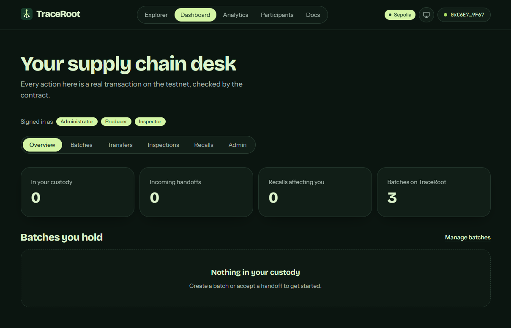
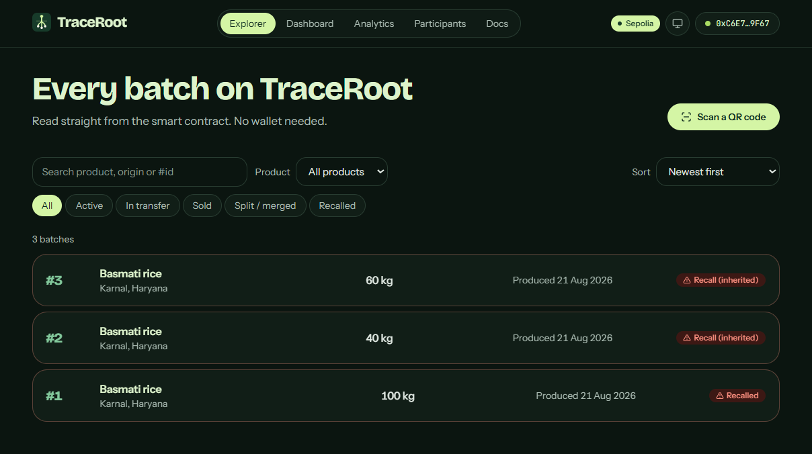
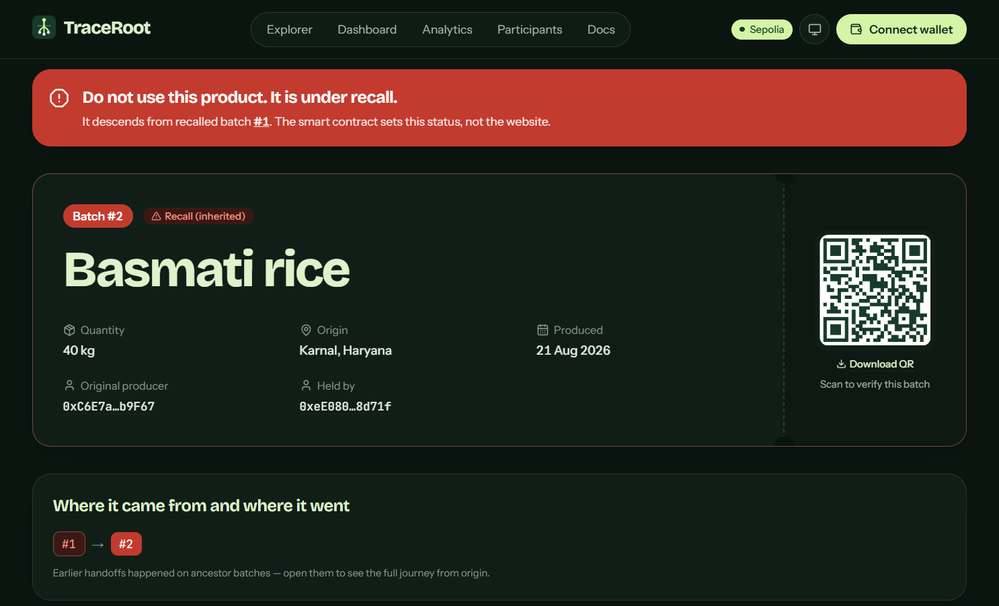
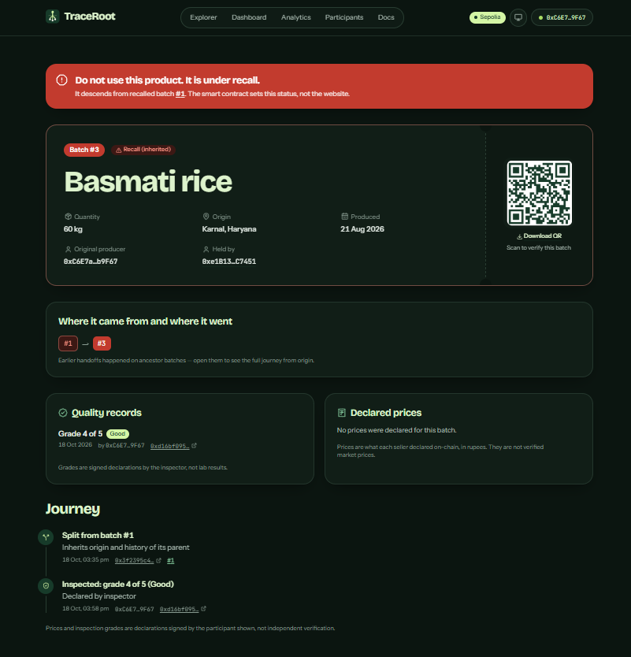
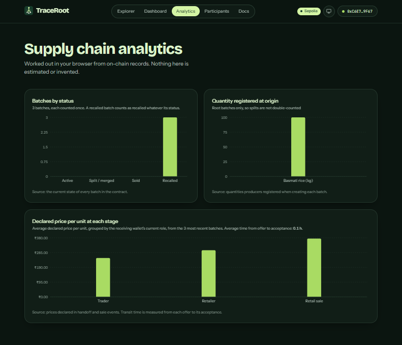
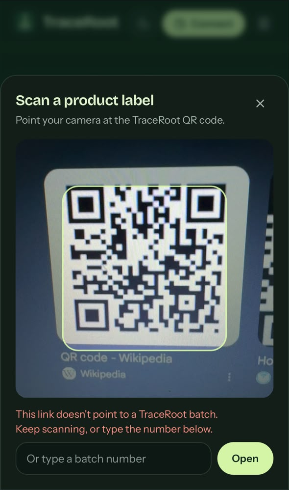

<div align="center">


# TraceRoot

**Every product has a story. Trace every batch. Verify every handoff.**

<!-- Tech stack -->


<br />


<br />


[**Live demo**](https://traceroot-chain.vercel.app) ·
[**Verified contract**](https://sepolia.etherscan.io/address/0x0B90219475dDa20b61FD59E68d2110397BEb3831#code) ·
[**Architecture**](docs/ARCHITECTURE.md) ·
[**Security notes**](docs/SECURITY.md)

</div>

---

TraceRoot is a blockchain supply-chain provenance platform. Every batch of a product is recorded from its origin to the shelf: who produced it, every handoff, every split and merge, inspections, declared prices and recalls. Anyone can scan the QR code on a label and see the full story, with no wallet or account.

<p align="center">
  
</p>

## Screenshots

All screenshots are from the live site on Sepolia.

| Dashboard | Explorer |
|---|---|
|  |  |
| **A sold batch under inherited recall** | **Quality records and journey** |
|  |  |
| **Analytics** | **On a phone** |
|  |   |

## Features

- **Two-step handoffs.** Custody moves only when the recipient confirms. Offers expire after 7 days and can be declined or withdrawn.
- **Quantity can't be created.** A split must add up exactly to the original, and a merge is the sum of its sources.
- **Recalls reach every descendant.** The contract checks a batch's whole ancestry, so a lot split off *before* the recall, or already sold, is still flagged.
- **Role-based access.** Producer, Trader, Transporter, Inspector, Retailer and Administrator, all enforced in Solidity.
- **QR verification on any phone.** Scan with the phone camera or the in-site scanner. Public pages need no wallet.
- **Honest UI.** Success is shown only after on-chain confirmation, demo content is labelled as an example, and prices and grades are shown as declarations, not facts.
- **Light and dark themes**, reduced-motion support, keyboard access, and no WCAG A/AA issues found by axe-core.

## How it works

```
Browser (Next.js + wagmi/viem) ──reads──▶ RPC ──▶ TraceRoot contract (source of truth)
        │                                            ▲
        └── MetaMask signs writes ───────────────────┘
```

- **No backend, no database, no indexer.** Every page reads the contract directly.
- **History without an indexer.** The contract stores the block numbers of each batch's events, so the site fetches logs for exactly those blocks. This works on free RPC limits.
- **Writes are simulated first,** so contract errors appear before you sign, in plain language.

## Try it

1. Open the [live demo](https://traceroot-chain.vercel.app) and browse the **Explorer**. Batch #1 is recalled, and #2 (sold) and #3 inherit the recall.
2. Open any batch and scan its QR code with your phone.
3. To act as a participant, connect MetaMask on Sepolia and ask the administrator for a role. The **Dashboard** then shows only the actions your role allows.

## Run locally

Requires Node.js 20+.

```bash
# 1. Contracts and tests
cd contracts
npm install
npx hardhat test                       # 51 tests

# 2. Local chain with demo data (keep this terminal open)
npx hardhat node
# in a second terminal, still in contracts/
npm run deploy:local && npm run seed:local

# 3. Website
cd ../web
npm install
printf "NEXT_PUBLIC_CHAIN=localhost\nNEXT_PUBLIC_CONTRACT_ADDRESS=0x5FbDB2315678afecb367f032d93F642f64180aa3\n" > .env.local
npm run dev                            # http://localhost:3000
```

To act as a participant locally, import one of Hardhat's printed test keys into MetaMask and add the network `http://127.0.0.1:8545` (chain ID 31337).

## Deploy your own (free)

1. Use a **test-only** MetaMask account, and get free Sepolia ETH from a faucet (Google Cloud Web3, QuickNode or Chainlink).
2. Copy `contracts/.env.example` to `contracts/.env`, then fill in `DEPLOYER_PRIVATE_KEY`, `SEPOLIA_RPC_URL` and a free `ETHERSCAN_API_KEY`. `.env` is git-ignored.
3. Deploy and verify:
   ```bash
   cd contracts
   npm run deploy:sepolia
   npx hardhat verify --network sepolia <address> <adminAddress>
   ```
4. Import the repo into **Vercel** with *Root Directory* `web`, and set `NEXT_PUBLIC_CHAIN=sepolia` and `NEXT_PUBLIC_CONTRACT_ADDRESS=<address>`.
5. Grant roles from **Dashboard → Admin**.

Polygon Amoy is also supported (`deploy:amoy`, `NEXT_PUBLIC_CHAIN=amoy`). The deploy script refuses any mainnet.

## Tests

| Suite | What it covers |
|---|---|
| **Contracts:** 51 Hardhat tests | Full workflow with state and event checks, unauthorized callers, boundary values, recall inheritance, quantity invariant. 100% line coverage |
| **Website:** 19 Vitest unit tests | Lineage, permissions, form parsing, error handling, QR validation, offer expiry |
| **Website:** 42 Playwright browser tests | The complete supply-chain journey with one wallet per role, wrong network, RPC failures, themes, keyboard access, and QR scanning with a simulated camera |

CI runs the contract tests, type check, lint, unit tests and build on every push. See [`web/tests/e2e/README.md`](web/tests/e2e/README.md) to run the browser tests.

## Project structure

```
contracts/   Solidity contract, Hardhat tests, deploy scripts
web/         Next.js app: pages, components, contract client, tests
docs/        Architecture, security review, progress log, screenshots
```

## Limitations

- A blockchain proves **who signed what, and when**. It can't see inside a sack of rice. Grades and prices are declarations by accountable participants.
- One administrator key controls roles. A real deployment should use a multisig.
- List pages read the newest 500 batches. A larger network would need an indexer.
- MetaMask may show a "Continue at your own risk" warning for this new `vercel.app` site. The contract is verified and the code is open.

These are automated tests and a self-review, not a formal audit. Details are in [`docs/SECURITY.md`](docs/SECURITY.md).

---

<div align="center">

Built by **Sujal Tyagi** · [GitHub](https://github.com/Sujal-tyagi17)

</div>
